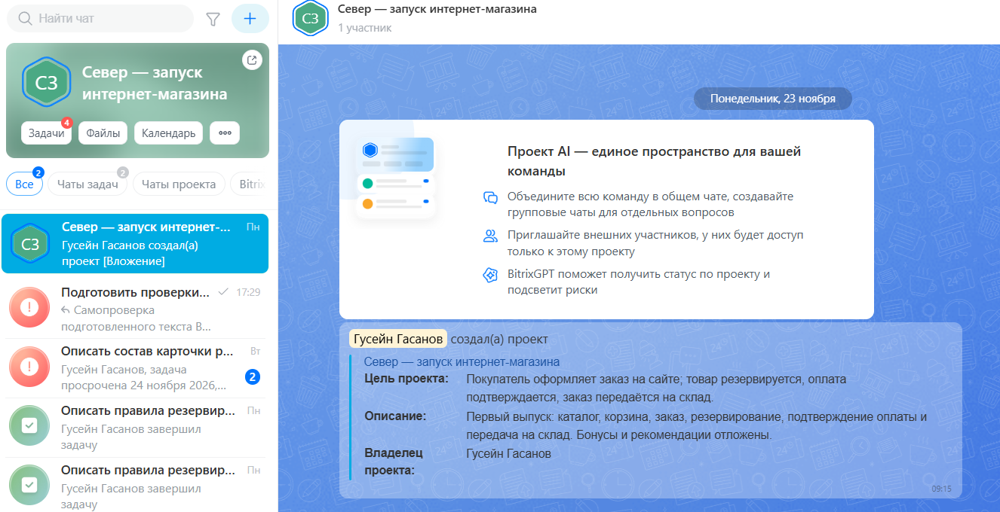
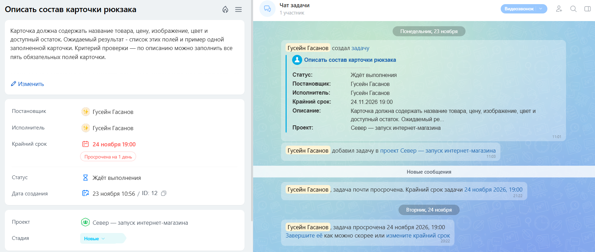
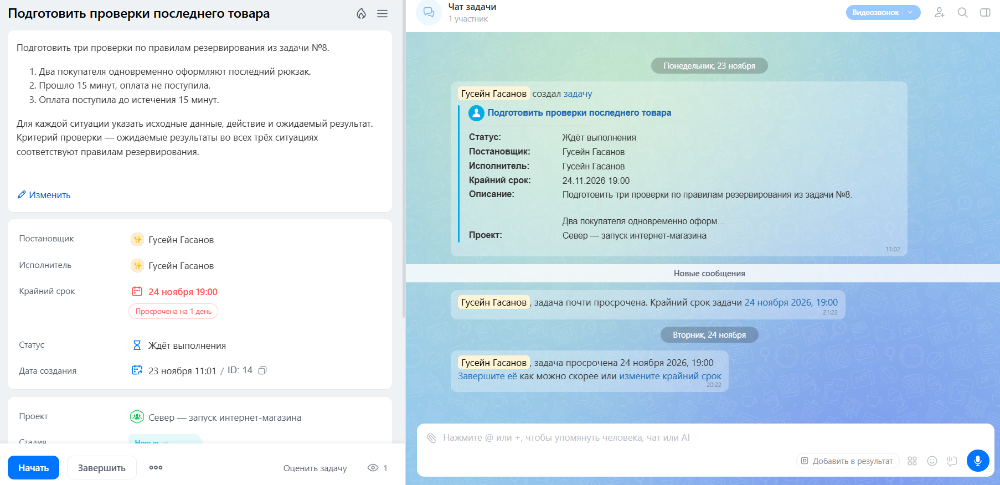

# Отчёт по теме 2. Проект, задача и результат

Репозиторий: https://github.com/Guseyn-99/project-management

Проект: https://b24-wu4kfw.bitrix24.ru/online/?IM_COLLAB=chat10

Задача 1: https://b24-wu4kfw.bitrix24.ru/company/personal/user/1/tasks/task/view/8/

Задача 2: https://b24-wu4kfw.bitrix24.ru/company/personal/user/1/tasks/task/view/12/

Задача 3: https://b24-wu4kfw.bitrix24.ru/company/personal/user/1/tasks/task/view/14/

## 1. Проект «Север — запуск интернет-магазина»

В сообщении о создании проекта указаны цель и объём первого выпуска. В него входят каталог, корзина, заказ, резервирование, подтверждение оплаты и передача заказа на склад.

## 2. Постановка задачи о резервировании

В задаче №8 указаны условие, ожидаемый результат, критерий проверки, исполнитель и крайний срок. Задача привязана к проекту «Север».

## 3. Результат

В чате задачи №8 опубликованы три правила и два примера. При двух одновременных запросах резерв получает один покупатель. Через 15 минут без подтверждённой оплаты неоплаченный резерв снимается.

## 4. Самопроверка

В чате задачи №8 отдельным сообщением зафиксирована проверка обоих примеров по описанным правилам.

## 5. Завершение

После самопроверки задача №8 переведена в статус «Завершена».

## 6. Карточка рюкзака

В задаче №12 указаны пять обязательных полей, ожидаемый результат и критерий его проверки.

## 7. Проверки последнего товара

На снимке задачи №14 сохранено исходное описание с тремя ситуациями и условиями подготовки проверок. Дальнейшая работа с этой задачей отражена в [отчёте по теме 3](../lesson_03/report.md).

