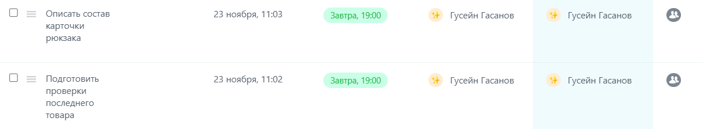
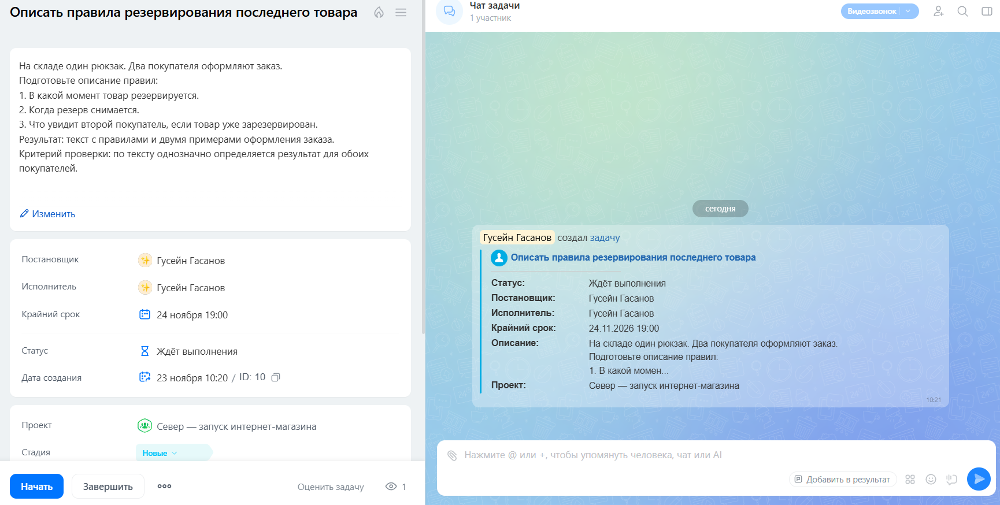
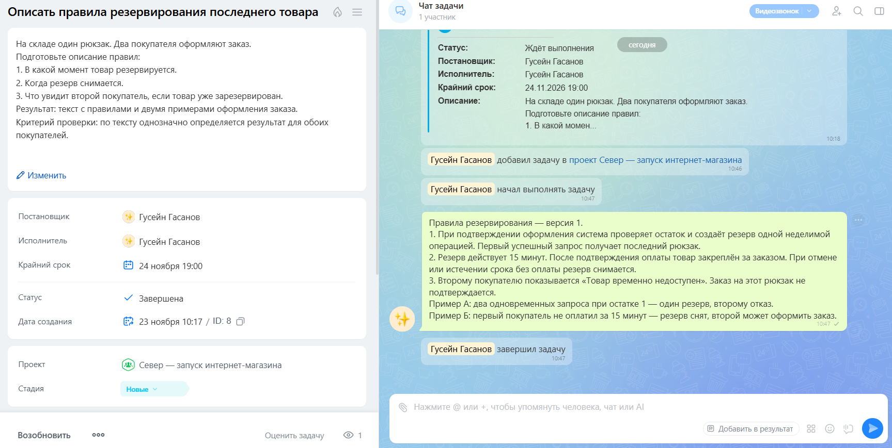
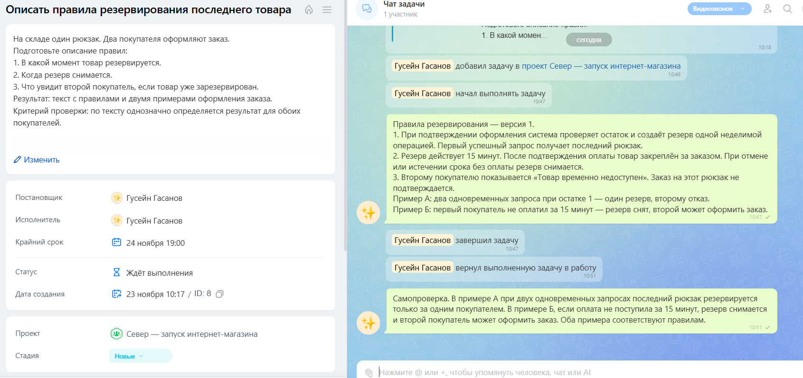
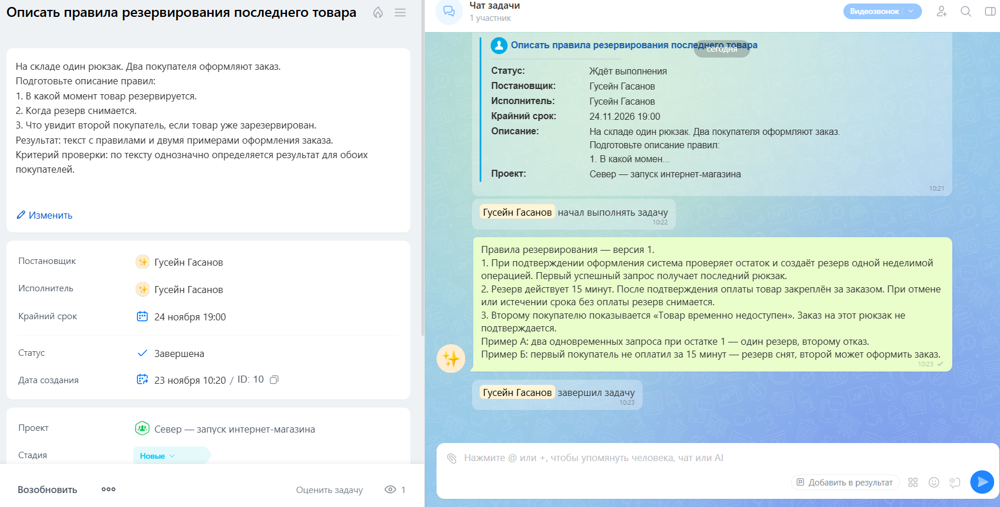
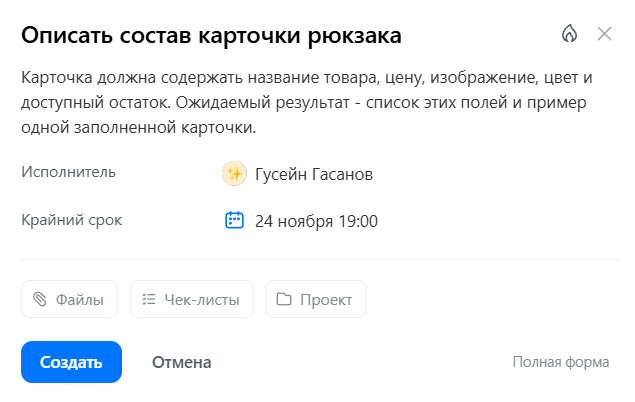
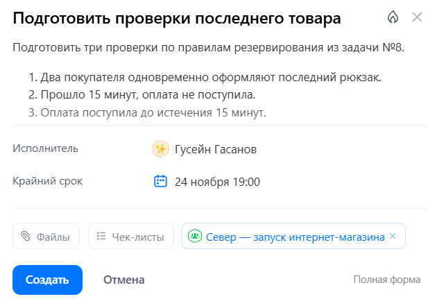

# Отчёт по теме 2. Проект, задача и результат

| Поле | Сведения |
| --- | --- |
| Репозиторий | [Guseyn-99/project-management](https://github.com/Guseyn-99/project-management) |
| Проект | «Север — запуск интернет-магазина» |
| Задача 1 | «Описать правила резервирования последнего товара», №8 |
| Задача 2 | «Описать состав карточки рюкзака» |
| Задача 3 | «Подготовить проверки последнего товара» |

## 1. Проект

Связь с проектом «Север — запуск интернет-магазина» видна в [карточке задачи №8](screenshots/02-task-reservation.png). На снимке ниже две следующие задачи уже отображаются в списке Битрикс24. Отдельный кадр с целью проекта и границами первого выпуска не приложен.

## 2. Условия первой задачи

На складе один рюкзак, а заказ оформляют два покупателя. В карточке №8 указаны ожидаемый результат, критерий проверки, исполнитель и крайний срок — 24 ноября, 19:00.

## 3. Сохранённый результат

В чате задачи №8 опубликованы три правила и два примера. При одновременных запросах последний рюкзак резервируется за одним покупателем. Если оплата не поступает за 15 минут, резерв снимается.

## 4. Проверка результата

В чате задачи №8 отдельным сообщением опубликована самопроверка обоих примеров.

## 5. Завершение

После самопроверки задача №8 завершена. На снимке видны статус «Завершена» и сообщение о завершении.

## 6. Следующая задача — карточка товара

В форме создания указаны пять обязательных полей: название, цена, изображение, цвет и доступный остаток. Ожидаемый результат — список полей с примером заполненной карточки. Запись о созданной задаче видна в списке в разделе 1.

## 7. Следующая задача — проверки

В форме создания указаны три ситуации: два покупателя оформляют последний рюкзак одновременно, резерв истекает без оплаты, оплата поступает до истечения резерва. Запись о созданной задаче видна в списке в разделе 1.

Прямые ссылки из Битрикс24 и отдельные снимки сохранённых карточек задач 2 и 3 не приложены.
