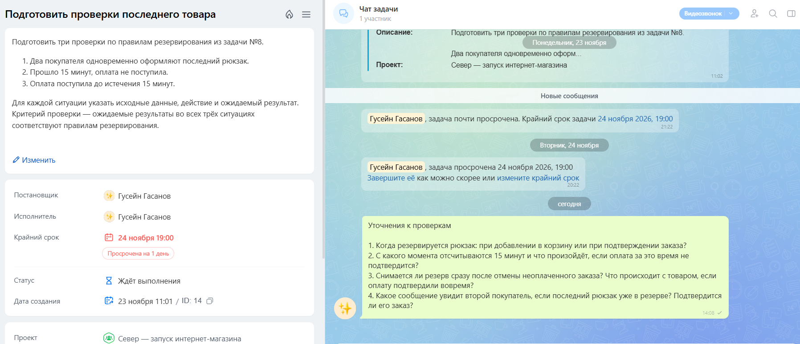
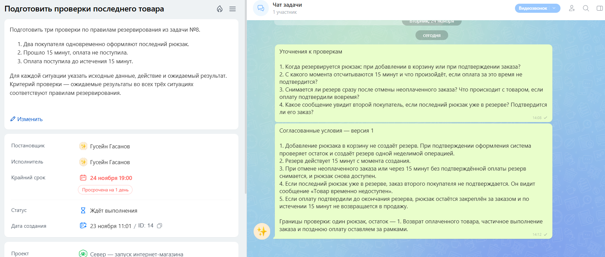
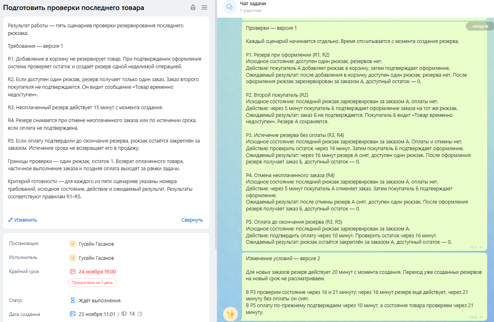
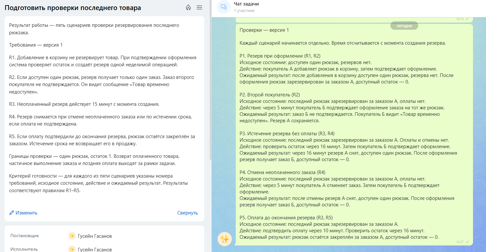
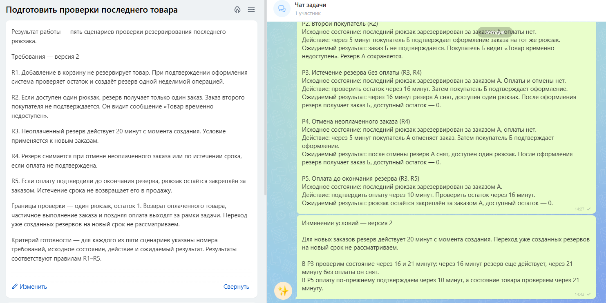
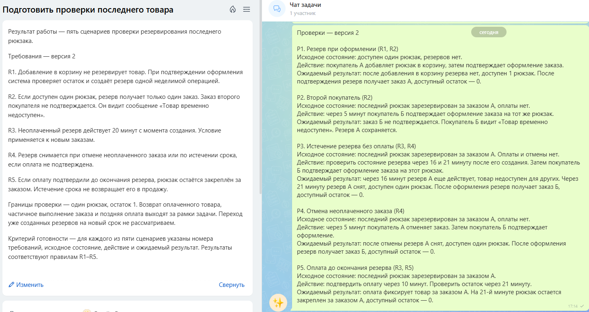
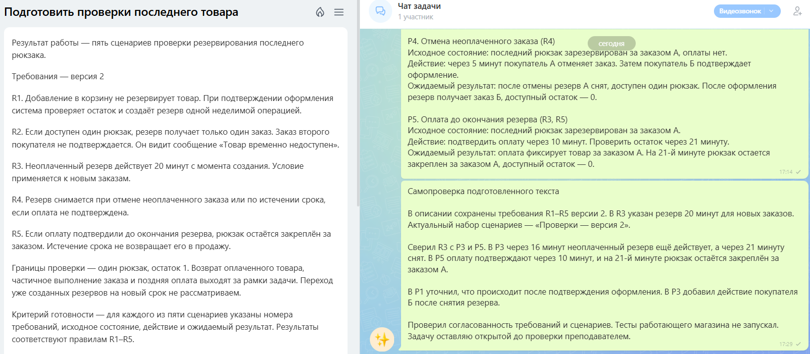

# Практика 3. Уточняем требования в Битрикс24

| Поле | Сведения |
| --- | --- |
| Выполнил | Гасанов Гусейн |
| Группа | 11/2-РПО-25/1 |
| Проект | «Север — запуск интернет-магазина» |
| Задача | №14 «Подготовить проверки последнего товара» |
| Ссылка на задачу | https://b24-wu4kfw.bitrix24.ru/company/personal/user/1/tasks/task/view/14/ |
| Задание преподавателя | [Уточняем требования в Битрикс24](https://algorthimization-course-vvodnoe.vercel.app/upravlenie-programmnymi-proektami/lessons/03-trebovaniya/index.html) |

## 1. Вопросы заказчику

В чате задачи зафиксированы четыре вопроса о моменте создания резерва, его сроке, отмене, оплате и отказе второму покупателю.

## 2. Согласованные условия

В чате сохранены исходные условия. Резерв создаётся при подтверждении оформления и действует 15 минут. При отмене неоплаченного заказа или истечении срока без оплаты рюкзак снова доступен.

## 3. Требования версии 1

В описании задачи зафиксированы требования R1–R5, границы работы и формат сценариев. На снимке исходный срок в R3 виден в левой части карточки.

## 4. Сценарии версии 1

В чате опубликованы пять сценариев P1–P5. В P3 на 16-й минуте неоплаченный резерв уже снят. В P5 после своевременной оплаты рюкзак остаётся закреплён за заказом.

## 5. Новые условия и требования версии 2

Для новых заказов срок резерва увеличен до 20 минут. Решение записано в чате, описание задачи обновлено. Переход ранее созданных резервов на новый срок остался за рамками задачи.

## 6. Сценарии версии 2

В чате опубликован актуальный набор P1–P5. Каждый сценарий содержит номер связанного требования, исходное состояние, действие и ожидаемый результат.

| Сценарий | Требования | Ожидаемый результат |
| --- | --- | --- |
| P1. Резерв при оформлении | R1, R2 | Корзина оставляет остаток 1. Подтверждение оформления создаёт резерв А и уменьшает доступный остаток до 0. |
| P2. Второй покупатель | R2 | Заказ Б не подтверждается. Резерв А сохраняется. |
| P3. Истечение срока | R3, R4 | На 16-й минуте резерв А ещё действует. На 21-й минуте без оплаты он снят. После оформления заказа Б резерв принадлежит Б. |
| P4. Отмена заказа | R4 | Отмена неоплаченного заказа А освобождает рюкзак, и заказ Б может получить резерв. |
| P5. Своевременная оплата | R3, R5 | Оплата на 10-й минуте закрепляет товар за заказом А. На 21-й минуте товар всё ещё закреплён. |

## 7. Самопроверка

Требования и сценарии сверены по тексту. В P1 уточнён результат подтверждения заказа. В P3 явно добавлено оформление заказа покупателем Б после снятия резерва А. Магазин не запускался. Задача оставлена открытой до проверки преподавателем.

