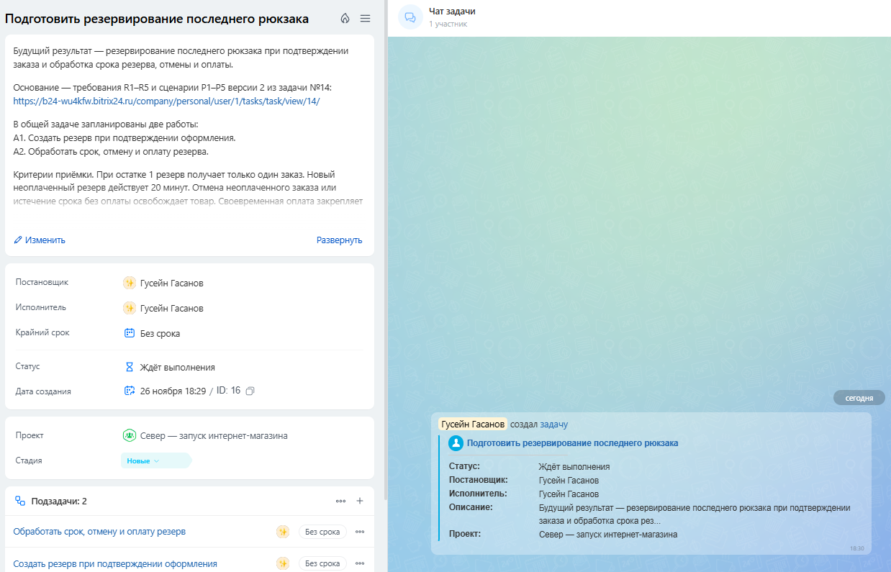
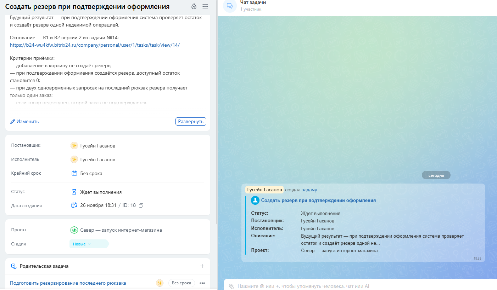
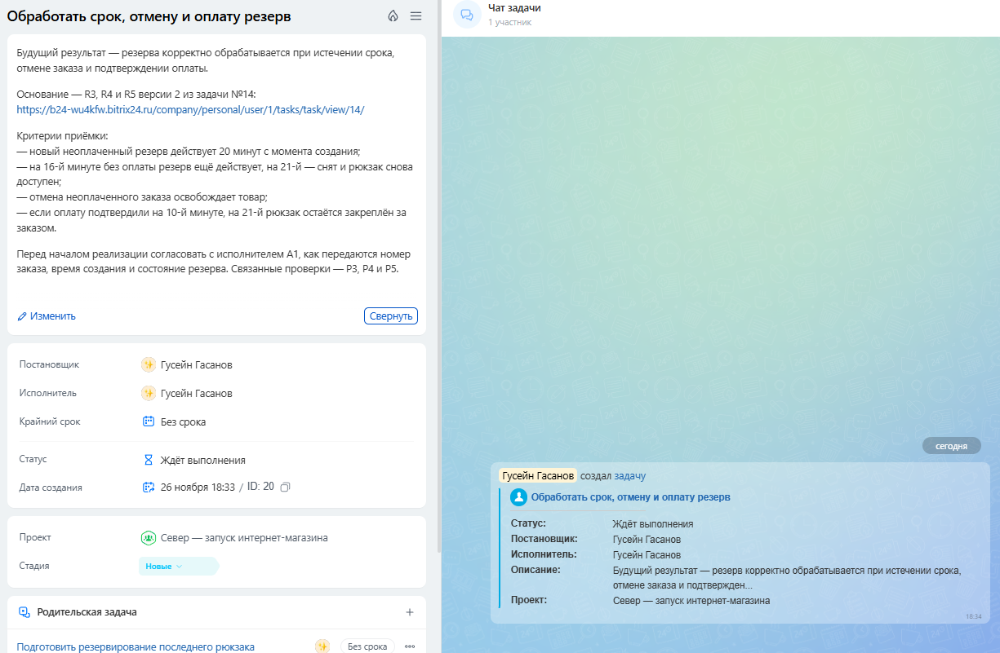
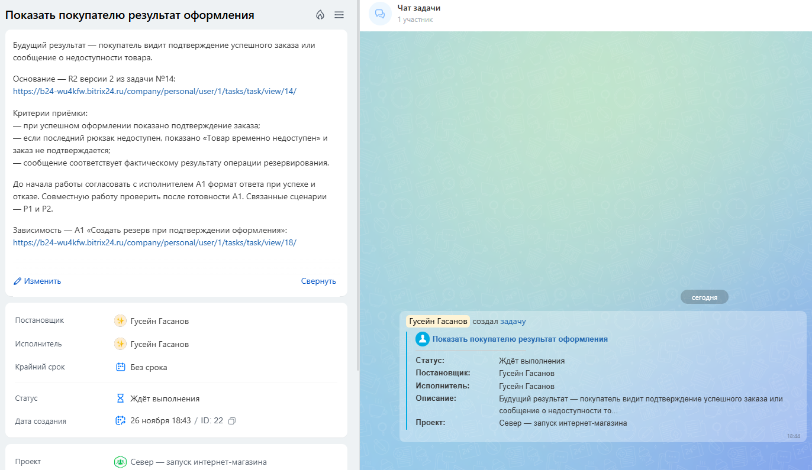
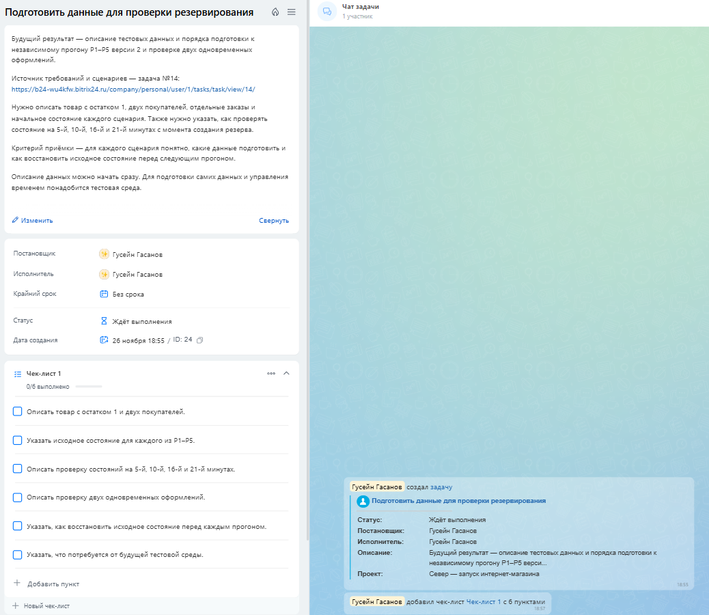
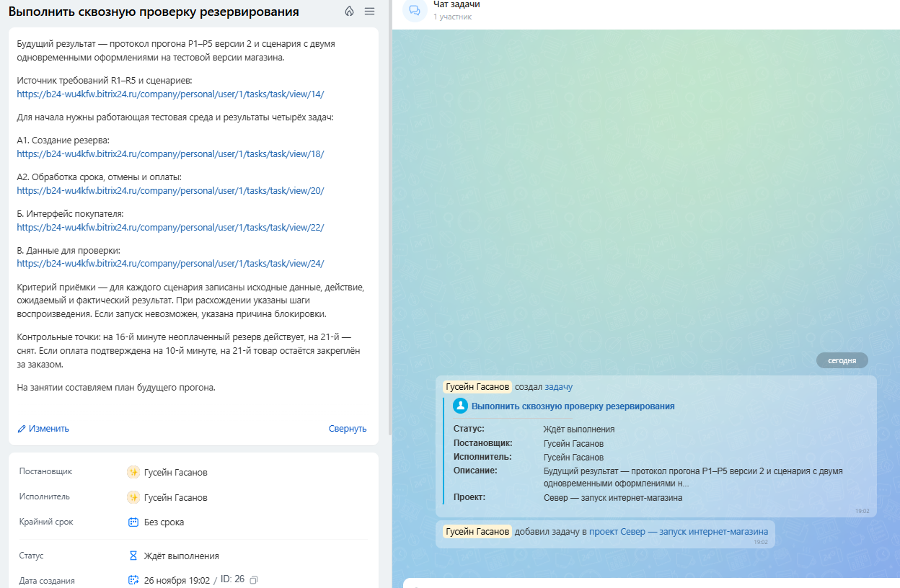
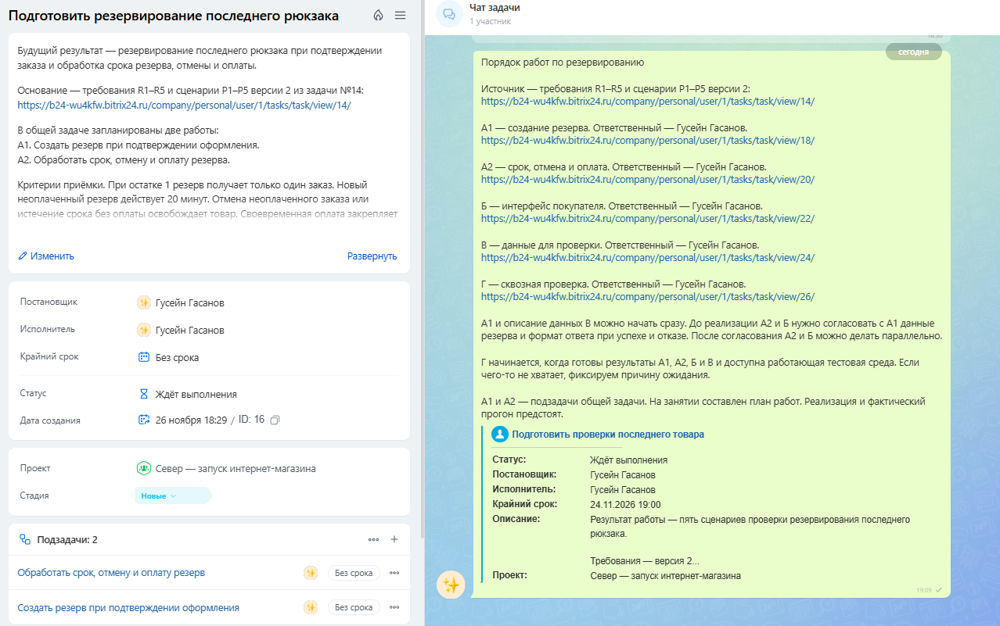
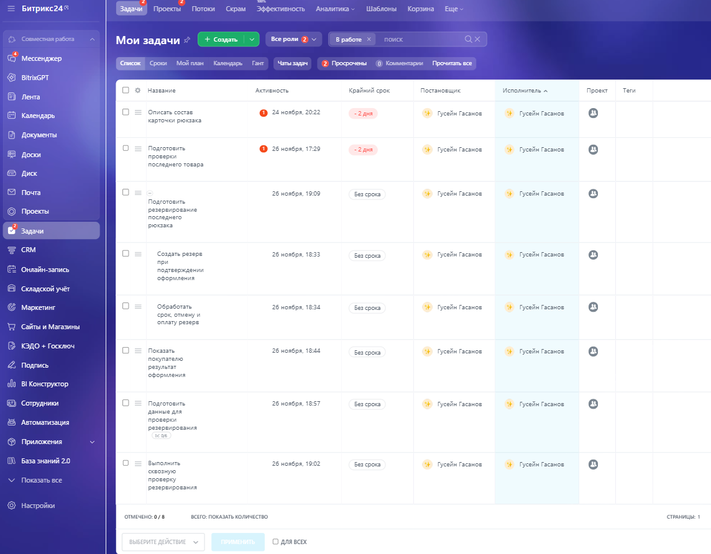

# Практика 04. От требований к плану работ

Репозиторий: https://github.com/Guseyn-99/project-management

Проект: https://b24-wu4kfw.bitrix24.ru/online/?IM_COLLAB=chat10

Источник требований: https://b24-wu4kfw.bitrix24.ru/company/personal/user/1/tasks/task/view/14/

Общая задача: https://b24-wu4kfw.bitrix24.ru/company/personal/user/1/tasks/task/view/16/

А1: https://b24-wu4kfw.bitrix24.ru/company/personal/user/1/tasks/task/view/18/

А2: https://b24-wu4kfw.bitrix24.ru/company/personal/user/1/tasks/task/view/20/

Б: https://b24-wu4kfw.bitrix24.ru/company/personal/user/1/tasks/task/view/22/

В: https://b24-wu4kfw.bitrix24.ru/company/personal/user/1/tasks/task/view/24/

Г: https://b24-wu4kfw.bitrix24.ru/company/personal/user/1/tasks/task/view/26/

## План работ

А1 и описание данных В можно начать сразу. Перед А2 и Б нужно согласовать с исполнителем А1 данные резерва и формат ответа. Задача Г начинается после готовности А1, А2, Б и В и появления тестовой среды. Шесть карточек оставлены открытыми. Реализация и фактический прогон запланированы отдельно.

## Скриншоты

### 1. Общая задача и подзадачи

### 2. А1 — создание резерва

### 3. А2 — срок, отмена и оплата

### 4. Б — интерфейс покупателя

### 5. В — данные для проверки

### 6. Г — сквозная проверка

### 7. Порядок работ

### 8. Список незавершённых задач

